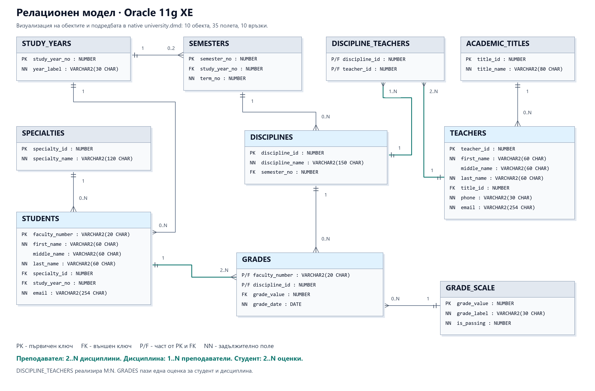

# Oracle University Database

An Oracle SQL / PL/SQL portfolio project by **Dimitar Atanasov**.

## Design

- 11 tables, 39 columns, 12 foreign keys and reviewed normalization.
- DISCIPLINES is the catalogue; CURRICULUM specifies specialty and semester.
- DISCIPLINE_TEACHERS has PK `(curriculum_id,teacher_id)`.
- GRADES has PK `(faculty_number,curriculum_id)` and FK `(curriculum_id,teacher_id)` to the teaching assignment.
- A grade must match the student's specialty. Teachers require explicit assignments in that specialty.
- At least two graded courses per student and two distinct catalogue courses per teacher.
- Full CRUD for every table: **44 executed operations and 56 checks**, including exact restoration after rollback.
- Five reports, transactions, savepoints, sequences, BEFORE/AFTER triggers, procedures and cursors.
- Native Data Modeler logical, relational and Oracle physical metadata.

The same SA course is in semester 6 for SIT and semester 4 for KST. Teacher 1 is assigned
to both; teacher 2 only to KST. Real teacher-login tests prove KST permission does not authorize SIT grading.
Data: 20 students, 6 teachers, 15 courses, 46 curriculum entries, 53 assignments, 64 grades.
All sample names, contacts and grades are fictional.

## Run locally

Tested on Oracle Database 11g XE 11.2.0.2, SQL Developer and Data Modeler 18.2.
Create an empty UNIVERSITY_PROJECT schema with CREATE SESSION, TABLE, VIEW, SEQUENCE,
PROCEDURE, TRIGGER and sufficient quota in USERS. Choose a local password.

1. Open `sql/13_build.sql` and run with F5. It creates programs, data and checks and refuses to overwrite existing objects.
2. Run `sql/06_reports.sql`, `sql/18_crud_all_tables.sql` and `sql/23_curriculum_validation.sql`.
3. Open `models/university.dmd` with the entire accompanying `university/` folder.

Demo and validation changes roll back; sequences may advance. Sample-data scripts intentionally commit.
Use an ASCII path with legacy SQL*Plus 11g. Script 24 is a one-time migration from the previous
ten-table grading release; back up first because Oracle DDL commits implicitly. Scripts 15 and 21
are historical migrations and must not run against the current schema.

Each instructor uses UP_TEACHER_<teacher_id>, with CREATE SESSION and EXECUTE only on
UNIVERSITY_PROJECT.TEACHER_GRADING. The package derives identity from SESSION_USER and the
curriculum from the student's specialty. No teacher ID is accepted from the teacher.
Teachers cannot access base tables or UNIVERSITY_API. The schema owner remains trusted.
Account creation is a separate, explicitly authorized local administrator step using
scripts/Initialize-TeacherAccounts.ps1. Credentials stay local under Windows DPAPI.

Use explicit *_curriculum_teacher methods for specialty-specific administrative assignments.
Legacy catalogue-only helpers select the lowest curriculum_id; they do not grant every specialty.
Use update_curriculum for semester changes.

## Verification

**304 Oracle checks** and **371 native model structural checks** passed.

| Suite | Checks | Evidence |
|---|---:|---|
| Core rules | 47 | [Output](results/validation.txt) |
| Procedures and cursors | 34 | [Output](results/lesson-validation.txt) |
| Many-to-many teaching | 47 | [Output](results/many-teachers-validation.txt) |
| Concurrent sessions | 10 | [Output](results/concurrency-validation.txt) |
| CRUD and restoration | 56 | [Output](results/crud-all-tables.txt) |
| DELETE safety | 20 | [Output](results/crud-validation.txt) |
| Grade assignment FK | 16 | [Output](results/grade-teacher-validation.txt) |
| Six real teacher accounts | 49 | [Output](results/teacher-authorization.txt) |
| Curriculum rules | 25 | [Output](results/curriculum-validation.txt) |
| Native models | 371 | [Output](results/model-validation.txt) |

The [cold build](results/full-build-validation.txt) ran in an empty temporary schema that was
then removed. Repeated checks are not counted twice. [Migration comparisons](results/curriculum-data-preservation.txt)
independently confirm all original rows and fields, including 60 original grade values, dates and authors.
The owner opened and saved both models in Data Modeler. Diagrams are rendered from native metadata, not GUI screenshots.

## Documentation

- [Curriculum and SIT/KST example](docs/curriculum-change.md)
- [Tables and normalization](docs/data-dictionary.md)
- [Relationships](docs/relationship-matrix.md)
- [CRUD](docs/crud-coverage.md)
- [Teacher authorization](docs/grading-authorization.md)
- [Usage and reports](docs/usage-and-results.md)
- [Logical diagram](docs/diagrams/logical.pdf) / [relational diagram](docs/diagrams/relational.pdf)
- [Activity](docs/activity-log.md) / [proposed commits](docs/review-of-changes.md)
- [Pre-commit review](docs/pre-commit-review.md) / [commit history](docs/commit-log.md)

The pre-commit review adds 66 storage-metadata checks covering every Oracle physical
column, key, index and CHECK proxy. Existing teacher account privileges are verified
again when the setup helper is rerun; saved credentials alone are not treated as proof.

Scope: one current specialty per student, one course occurrence per specialty and one current grade.
Academic years, retakes and full edit history are not modeled. NOWAIT table locks serialize
coursework-scale writes; a larger system would need finer-grained concurrency.
The private academic report, real student identifier and original materials are excluded.
